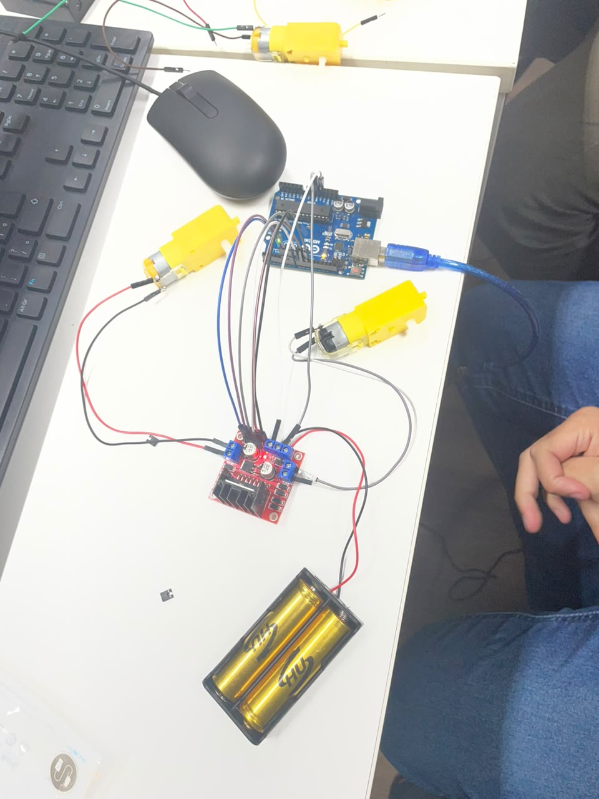

# carrinho_robo

**Disciplina/Projeto:** Project-based Maker Lab — FIAP
**Integrantes:**
- Açussena Macedo Mautone - 552568
- Felipe Heilmann Marques - 551026
- Felipe Voidela Toledo - 98595
- Carlos Eduardo Caramante Ribeiro - 552159
- Ian Cancian Nachtergaele - 98387

## Evolução do projeto

| Check Point | O que foi feito | Onde está |
|---|---|---|
| **CP1** | Especificação do carrinho (MVP, backlog, Kanban, custos), chassi em 3D, circuito e teste dos motores | [`organizacao/`](organizacao), [`cad/`](cad), [`src/codigo.ino`](src/codigo.ino), seção [CP1](#cp1--documentação-técnica-do-chassi) abaixo |
| **CP2** | **TinyML**: dataset com o sensor ultrassônico do carrinho → modelo treinado no Edge Impulse → inferência embarcada na ESP32-S3 → o resultado comanda os motores | **[`cp2/`](cp2)** |

---

## CP2 — TinyML com Edge Impulse e ESP32

📁 **Pasta do CP2: [`cp2/`](cp2)** · leia primeiro o [README do CP2](cp2/README.md)

O carrinho (kit LAFVIN R3 com câmera) usa o **sensor ultrassônico HC-SR04** para medir a distância à frente 20 vezes por segundo. Um modelo de Machine Learning treinado no Edge Impulse roda **dentro da ESP32-S3** do módulo de câmera, classifica cada janela de 1 s e decide o movimento:

| Classe | O que o modelo reconhece | Ação no carrinho |
|---|---|---|
| `livre` | nada perto à frente | anda rápido (LED verde) |
| `aproximando` | algo se aproximando, ou o carrinho chegando perto de algo | anda devagar (LED laranja) |
| `obstaculo` | algo parado bem perto | dá ré e vira (LED vermelho) |

| Etapa | Resultado | Documentação |
|---|---|---|
| Coletar | 66 amostras CSV, 1565 leituras reais do sensor do carrinho | [cp2/docs/coleta.md](cp2/docs/coleta.md) · [cp2/dados/](cp2/dados) |
| Treinar | Edge Impulse: Raw Data + rede neural; 94,1% na validação | [cp2/docs/edge_impulse.md](cp2/docs/edge_impulse.md) |
| Testar | **96,55%** em dados nunca vistos; matriz de confusão e prints | [cp2/edge_impulse/prints/](cp2/edge_impulse/prints) |
| Embarcar | biblioteca Arduino exportada (`cp2_tinyml_inferencing`) | [cp2/edge_impulse/biblioteca/](cp2/edge_impulse/biblioteca) |
| Inferir | `run_classifier()` na ESP32-S3, menos de 1 ms por inferência | [cp2/esp32/carrinho_tinyml/](cp2/esp32/carrinho_tinyml) |
| Agir | a ESP32 envia a ação à R3, que move os motores | [cp2/r3/carrinho_r3/](cp2/r3/carrinho_r3) · [cp2/docs/integracao.md](cp2/docs/integracao.md) |

**Mudança de hardware em relação ao CP1:** a especificação do CP1 previa ESP32 + ponte H com 2 motores. O grupo adotou o kit LAFVIN R3 completo, com 4 motores, shield com driver TB6612, ultrassônico e módulo ESP32-S3 com câmera, como já estava na planilha de custos em [`organizacao/`](organizacao). No CP2, a placa R3 cuida dos motores e do sensor, e a ESP32-S3 roda o modelo.

---

## CP1 — Documentação Técnica do Chassi

### 1. Ficha de Requisitos

#### 1.1 Dimensões gerais do chassi

Com base no modelo 3D (`chassi_robo_v3.stl`), o chassi possui estrutura de **dois andares**, unidos por colunas nos quatro cantos:

| Eixo | Medida |
|---|---|
| Comprimento (Y) | 200 mm |
| Largura (X) | 150 mm |
| Altura total (Z) | 59 mm |

- **Andar inferior** (~0 a 8 mm de altura): base onde ficam fixados os motores e as rodas.
- **Andar superior** (~40 a 59 mm de altura): plataforma para a placa controladora, ponte H e demais componentes eletrônicos, com um recorte retangular central (passagem de fiação/ventilação).
- **Colunas de sustentação**: 4 colunas nos cantos conectando os dois andares.

#### 1.2 Quantidade de motores

**2 motores DC** (motor esquerdo e motor direito), configuração de tração diferencial.

#### 1.3 Placa controladora

**ESP32** (conectividade Wi-Fi/Bluetooth integrada, permite controle remoto do robô).

#### 1.4 Posição dos componentes

| Componente | Posição no chassi |
|---|---|
| Motor esquerdo | Andar inferior, lateral esquerda |
| Motor direito | Andar inferior, lateral direita |
| Rodas | Acopladas aos motores, nas laterais do andar inferior |
| ESP32 | Andar superior, região central |
| Ponte H | Andar superior, próxima ao ESP32 (facilita conexão com os motores) |
| Bateria 18650 | Andar inferior ou superior, região central (centralizar o peso) |
| Sensor HC-SR04 | Andar inferior, parte frontal (furo central identificado no modelo, voltado para a frente do robô) |

#### 1.5 Carenagem (cobertura)

O andar superior funciona como **cobertura parcial** do robô, protegendo a fiação e os componentes eletrônicos do andar inferior. Possui um recorte retangular central para passagem de cabos e dissipação de calor. Não há cobertura lateral fechada — as laterais permanecem abertas para acesso aos motores e rodas.

---

### 2. Croqui do Chassi

O croqui foi modelado em 3D e está disponível no arquivo [`cad/chassi_robo_v3.stl`](./cad/chassi_robo_v3.stl) deste repositório. Abrindo o arquivo no GitHub, ele aparece num visualizador 3D.

Montagem do circuito de teste dos motores (19/08), com Arduino, ponte H L298N e bateria 18650 — código em [`src/codigo.ino`](./src/codigo.ino):

#### 2.1 Observação

Dimensões acima são teóricas, pois usaremos um carrinho pronto!

---

### 3. Tabela Dimensional dos Componentes

| Componente | Comprimento (mm) | Largura (mm) | Altura (mm) | Forma de fixação |
|---|---|---|---|---|
| Motor esquerdo | 70 | 37 | 23 | _(preencher)_ |
| Motor direito | 70 | 37 | 23 | _(preencher)_ |
| ESP32 | 49 | 25,5 | 7 | _(preencher)_ |
| Ponte H | 43 | 43 | 27 | _(preencher)_ |
| Bateria 18650 | 67 | 18 | 18* | _(preencher)_ |
| Sensor HC-SR04 | 45 | 20 | 15 | _(preencher)_ |

\* A bateria 18650 é cilíndrica (diâmetro 18 mm), por isso largura e altura coincidem quando ela é fixada deitada. Se o suporte (holder) for de outro tipo, ajuste esse valor.
