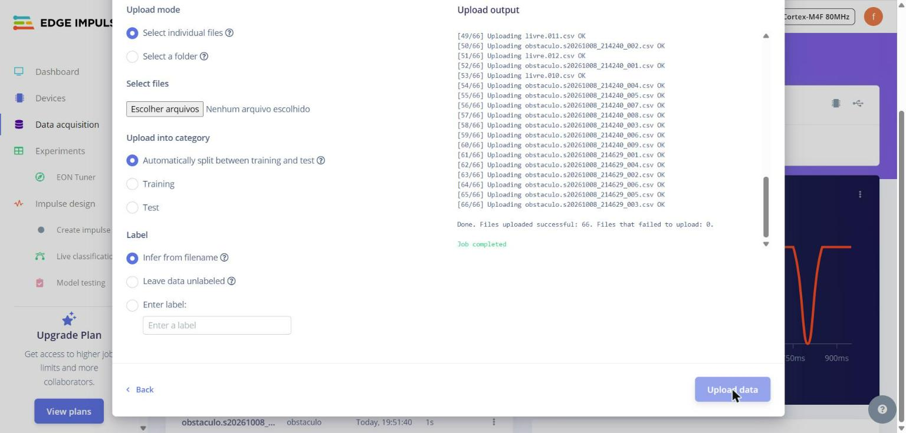
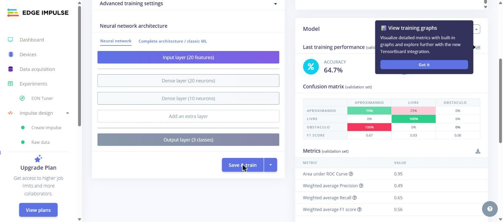
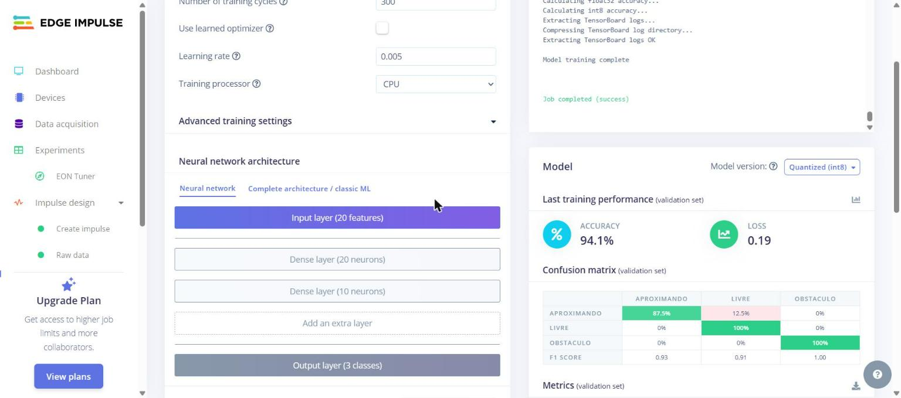
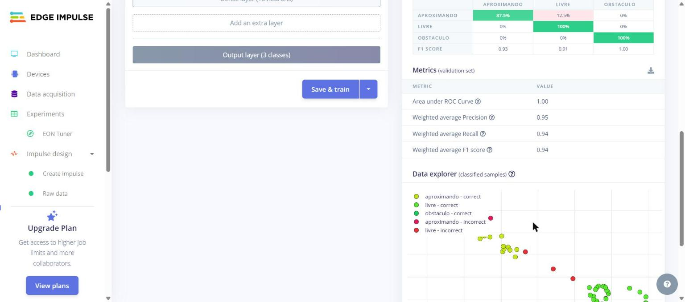
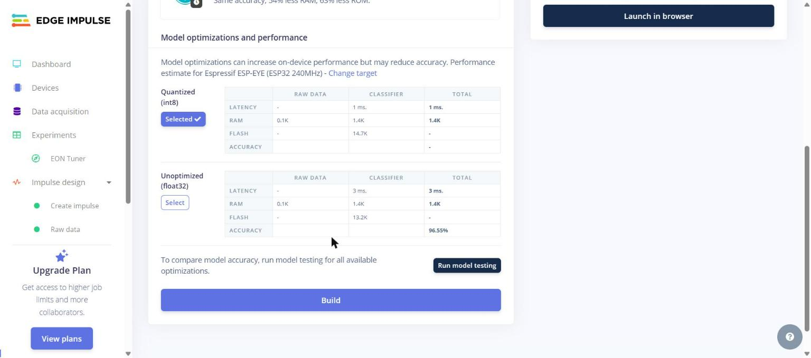
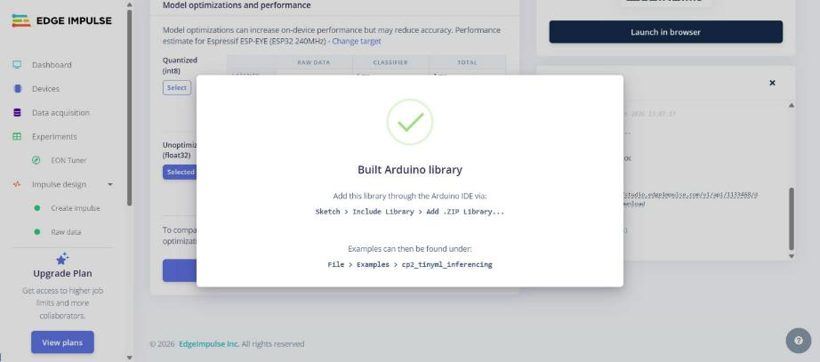

# Projeto no Edge Impulse

Projeto: **`cp2_tinyml`** (privado, ID 1133468), conta `felipevoidela`. Os prints ficam em [`edge_impulse/prints/`](../edge_impulse/prints/).

## 1. Importação dos dados

- **66 CSVs** de `dados/csv/` enviados pelo *Data acquisition → Add data → Upload data*.
- **Rótulo:** *Infer from filename* (`livre.001.csv` → `livre`).
- **Divisão:** *Automatically split between training and test*.
- O Edge Impulse leu a coluna `timestamp` e reconheceu o intervalo de **50 ms (20 Hz)**, com o eixo `distancia`.

## 2. Divisão dos dados

| Conjunto | Amostras | aproximando | livre | obstaculo | Duração |
|---|---|---|---|---|---|
| Treino | 53 | 32 | 8 | 13 | 61,8 s |
| Teste | 13 | 7 | 4 | 2 | 17,2 s |
| **Total** | **66** | 39 | 12 | 15 | **1 min 19 s** |

Proporção 78% / 22%. Dentro do treino, o Edge Impulse ainda separa 20% para validação.

## 3. Configuração do Impulse

| Bloco | Configuração |
|---|---|
| Time series data | eixo `distancia`, **janela 1000 ms**, **passo 250 ms**, frequência **20 Hz**, zero-pad ligado |
| Processamento | **Raw Data**, *scale axes* = **0,0067** (≈ 1/150, deixa a distância entre 0 e 1) |
| Aprendizado | **Classification** (rede neural Keras) |
| Saída | 3 classes: `aproximando`, `livre`, `obstaculo` |

**Por que Raw Data:** a classe `aproximando` depende da *ordem* das leituras (a distância caindo ao longo de 1 s). O Raw Data entrega as 20 leituras em sequência para a rede. Blocos que resumem a janela, como o Flatten (média, mínimo, máximo), perderiam essa informação. Com uma única grandeza a 20 Hz, blocos espectrais (FFT) não fazem sentido.

## 4. Processamento (features)

- **85 janelas** de treino: aproximando 32, livre 40, obstaculo 13. As amostras de `livre` têm 2 s, então rendem mais janelas.
- **Custo no ESP32** (estimado pelo Edge Impulse): 0 ms e 80 bytes de RAM.
- **Feature explorer:** `livre` forma um grupo bem separado; `obstaculo` e `aproximando` ficam próximos, mas em regiões distintas.

## 5. Modelo e treinamento

Arquitetura: **entrada 20 → Dense 20 (ReLU) → Dense 10 (ReLU) → Softmax 3**. É uma rede pequena, porque o sinal tem só 20 valores.

| | Iteração 1 | Iteração 2 (final) |
|---|---|---|
| Ciclos de treino | 100 | **300** |
| Taxa de aprendizado | 0,0005 | **0,005** |
| Auto-weight classes | não | **sim** |
| Acurácia (validação) | 64,7% | **94,1%** |
| Loss | 0,74 | **0,19** |

**Análise da iteração 1:** todas as janelas de `obstaculo` foram classificadas como `aproximando` (F1 = 0,00). Isso tem duas causas:

1. `obstaculo` tem poucas janelas (13 contra 32 e 40), e a rede "preferiu" as classes maiores.
2. Com as entradas escaladas entre 0 e 1, a taxa de aprendizado de 0,0005 em 100 ciclos foi pouca para a rede convergir.

A iteração 2 corrigiu as duas coisas: deu pesos maiores à classe com menos exemplos e treinou com taxa de aprendizado maior por mais ciclos.

### Resultado do treino final (validação)

| real \ previsto | aproximando | livre | obstaculo |
|---|---|---|---|
| **aproximando** | **87,5%** | 12,5% | 0% |
| **livre** | 0% | **100%** | 0% |
| **obstaculo** | 0% | 0% | **100%** |
| F1 | 0,93 | 0,91 | 1,00 |

AUC 1,00 · precisão ponderada 0,95 · recall ponderado 0,94 · F1 ponderado 0,94.

## 6. Teste de inferência (dados nunca vistos)

*Model testing → Classify all* nas 13 amostras de teste:

| real \ previsto | aproximando | livre | obstaculo | incerto |
|---|---|---|---|---|
| **aproximando** | **85,7%** | 14,3% | 0% | 0% |
| **livre** | 0% | **100%** | 0% | 0% |
| **obstaculo** | 0% | 0% | **100%** | 0% |
| F1 | 0,92 | 0,98 | 1,00 | |

**Acurácia de teste: 96,55%** · AUC 1,00 · precisão 0,97 · recall 0,97 · F1 0,96.

**Leitura dos resultados**

- O único erro é **`aproximando` → `livre`**. Acontece quando o objeto ainda está longe (acima de ~60 cm) no começo da janela. Na prática, o carrinho só reduz a velocidade um pouco mais tarde.
- `obstaculo` nunca é confundido, e é a classe que aciona a manobra de desvio. Para a segurança do carrinho, esse é o erro que mais importaria.
- O conjunto de teste é pequeno (13 amostras, 29 janelas), e janelas vizinhas da coleta contínua podem ter caído em treino e teste. Por isso o número real no carrinho tende a ser um pouco menor. O teste no carrinho está em [integracao.md](integracao.md).

## 7. Exportação para o ESP32

*Deployment → Arduino library*, compilador **EON**, versão **float32** (a que foi testada, com 96,55%).

| Versão | Latência | RAM | Flash | Acurácia |
|---|---|---|---|---|
| Quantizada int8 | 1 ms | 1,4 KB | 14,7 KB | não testada |
| **float32 (escolhida)** | **3 ms** | **1,4 KB** | **13,2 KB** | **96,55%** |

Estimativas para o ESP32 a 240 MHz. A ESP32-S3 do módulo de câmera tem 8 MB de flash e PSRAM, então a diferença de tamanho não importa. Com uma inferência a cada 250 ms, 3 ms ocupam ~1% do tempo.

Arquivo gerado: [`edge_impulse/biblioteca/ei-cp2_tinyml-arduino-1.0.1.zip`](../edge_impulse/biblioteca/), com o header `cp2_tinyml_inferencing.h`.

